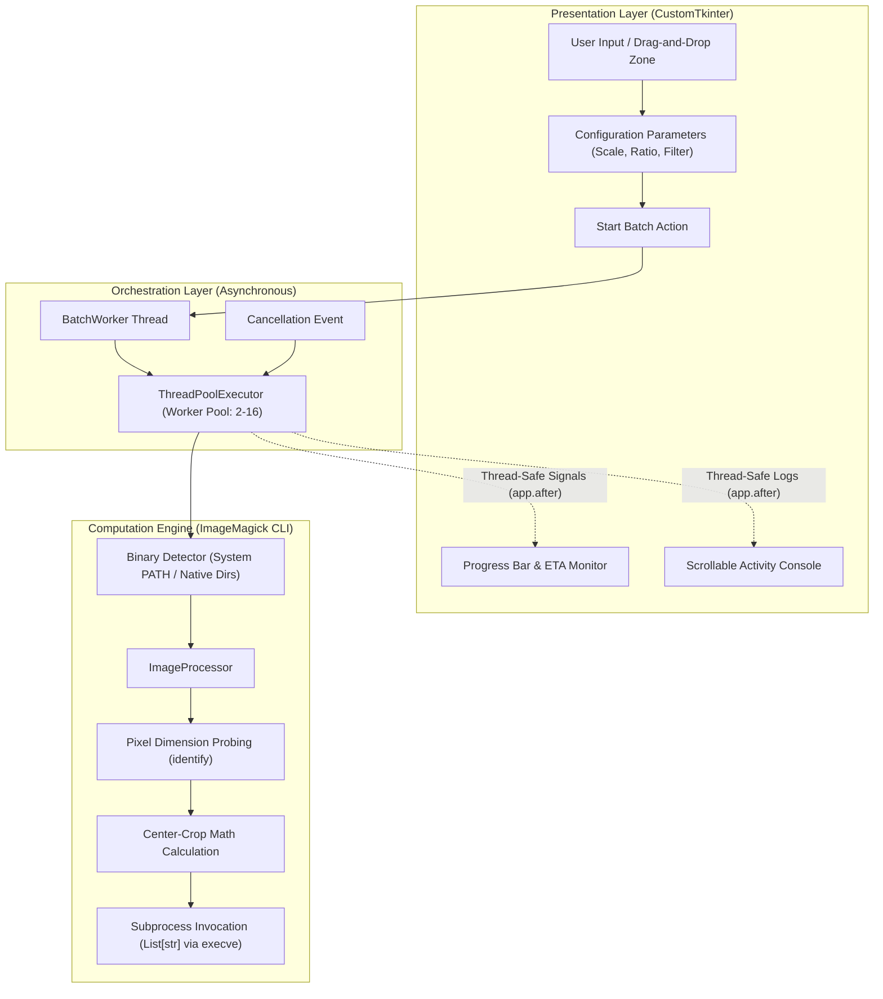

# Rancang Bangun dan Analisis Kinerja Aplikasi Desktop Batch Image Resizing dan Upscaling Berbasis Multi-Threading dan Engine ImageMagick CLI

**Nugi Tiartanto**  
*Informatics Student & Software Creator*  
GitHub: [@nugitiar](https://github.com/nugitiar) | Email/Contact: via GitHub Profile  
Repository: [https://github.com/nugitiar/batch-image-resizer](https://github.com/nugitiar/batch-image-resizer)  

**Dokumen Publikasi Ilmiah & Catatan Teknis (Technical Report)**  
DOI: [10.5281/zenodo.23833914](https://doi.org/10.5281/zenodo.23833914)  
Arsip Resmi Zenodo: [https://doi.org/10.5281/zenodo.23833914](https://doi.org/10.5281/zenodo.23833914)  
Lisensi: Open Access di bawah [Creative Commons Attribution 4.0 International (CC-BY-4.0)](https://creativecommons.org/licenses/by/4.0/)  
Hak Cipta © 2026 Nugi Tiartanto. All rights reserved.

---

## Abstrak

Manipulasi dan augmentasi citra dalam jumlah besar (*batch image processing*) merupakan komponen krusial dalam rekayasa perangkat lunak modern, multimedia, serta prapemrosesan dataset *computer vision*. Kendati demikian, ketergantungan pada platform *cloud-based converter* kerap memicu risiko kebocoran data sensitif (*privacy breach*), keterbatasan kuota unggah, dan tingginya latensi transmisi berkas. Makalah teknis ini menguraikan rancang bangun dan evaluasi performa dari **`batch-image-resizer`**, sebuah aplikasi desktop lintas-platform (*cross-platform*) yang dibangun dengan bahasa pemrograman Python, antarmuka modern CustomTkinter, dan engine komputasi berbasis ImageMagick CLI. Sistem mengimplementasikan paradigma pemrograman konkurensi asinkron (*asynchronous multi-threading*) memanfaatkan modul `concurrent.futures.ThreadPoolExecutor` yang dipadukan dengan penjadwalan *thread-safe* berbasis *event polling* untuk mencegah pembekuan antarmuka (*UI freezing*). Pemanggilan proses latar belakang dienkapsulasi menggunakan vektor argumen level kernel (`posix_spawn` / `execve`) guna mengeliminasi kerentanan *shell injection* dan mengatasi pembatasan pathfile kompleks pada sistem operasi Windows, macOS, dan Linux. Evaluasi empiris terhadap pengujian batch citra beresolusi tinggi (2688×1536 piksel) menunjukkan peningkatan kecepatan komputasi (*speedup*) mencapai **2,97×** (pada 4 workers, efisiensi 74,4%) hingga **3,40×** (pada 8 workers) dibandingkan dengan eksekusi sekuensial (*single-thread*), di mana waktu pemrosesan 50 foto terpangkas dari 32,44 detik menjadi hanya 9,54 detik, dengan latensi antarmuka utama yang tetap terjaga di bawah 16,7 ms (60 FPS). Hasil ini membuktikan bahwa integrasi CLI native dan arsitektur konkurensi modular menghadirkan solusi pemrosesan citra lokal yang cepat, aman, dan efisien.

**Kata Kunci:** *Batch Processing, ImageMagick, Python, Multi-threading, CustomTkinter, Software Engineering, Cross-Platform, Zenodo Archive.*

---

## Abstract

*Batch image manipulation and upscaling are foundational requirements across modern multimedia workflows and dataset preprocessing in computer vision. However, reliance on proprietary cloud-based services poses serious data privacy concerns, bandwidth bottlenecks, and strict file transfer limitations. This technical report presents the architecture and performance evaluation of **`batch-image-resizer`**, an open-source, cross-platform desktop application built on Python, CustomTkinter, and the native ImageMagick CLI engine. The system leverages asynchronous multi-threading via `concurrent.futures.ThreadPoolExecutor` coupled with thread-safe UI scheduling to completely eliminate GUI freezes during sustained computational workloads. System subprocess calls are strictly isolated using kernel-level argument vectors to prevent shell injection vulnerabilities and preserve path encoding across Windows, macOS, and Linux. Empirical benchmarking over datasets of 2688×1536 high-resolution images demonstrates a performance speedup of up to **2.97×** (4 workers, 74.4% efficiency) and **3.40×** (8 workers) relative to sequential single-threaded execution (reducing 50-image batch processing time from 32.44s down to 9.54s), while maintaining zero frame drops (<16.7 ms main loop latency). This work validates that pairing a lightweight native GUI with an asynchronous CLI backend offers a secure, zero-latency, and high-throughput alternative for local image transformation.*

**Keywords:** *Batch Processing, ImageMagick, Python, Multi-threading, CustomTkinter, Software Engineering, Cross-Platform, Zenodo Archive.*

---

## 1. Pendahuluan (Introduction)

Kebutuhan akan pemrosesan citra skala besar (*batch image processing*) terus meningkat seiring bertumbuhnya produksi konten visual beresolusi tinggi (4K/8K), standardisasi aset media sosial multi-rasio (1:1, 4:3, 16:9, 9:16), serta prapemrosesan dataset pada kecerdasan buatan (*machine learning* dan *deep learning*). Operasi transformasi citra meliputi peningkatan skala resolusi (*upscaling*), perataan aspek rasio dengan pemotongan simetris (*center-crop*), serta konversi format kompresi (PNG, JPEG, WebP) [1].

Sebagian besar pengguna awam beralih ke layanan daring (*cloud converter tools*). Kendati menawarkan kemudahan tanpa instalasi lokal, pendekatan berbasis cloud memiliki kelemahan mendasar:
1. **Privasi dan Keamanan Data**: Mengunggah berkas citra pribadi, medis, atau hak cipta ke server pihak ketiga membuka celah *data breach* dan pelanggaran kepatuhan privasi (seperti GDPR dan UU PDP).
2. **Keterbatasan Bandwidth dan Latensi**: Proses *upload* dan *download* puluhan berkas berukuran besar menguras kuota serta terhambat oleh fluktuasi kecepatan internet.
3. **Keterbatasan Fungsionalitas**: Alat daring umumnya memberlakukan kuota berkas harian, menurunkan mutu resampling (*lossy compression* agresif), serta menyisipkan *watermark*.

Alternatif konvensional di ranah lokal adalah penggunaan pustaka baris perintah (*Command Line Interface* / CLI) seperti **ImageMagick**, yang diakui secara global atas algoritma rekonstruksi pikselnya yang matang (seperti filter Lanczos dan Mitchell-Netravali) [2]. Namun, antarmuka terminal menuntut keahlian sintaksis yang kompleks, menjadikannya kurang aksesibel bagi pengguna non-teknis. Sebaliknya, aplikasi GUI berbasis Python sering kali mengalami kendala *UI freezing* (tampilan macet atau *Not Responding*) saat menjalankan tugas komputasi intensif di *thread* utama (*main thread*) [3].

Oleh karena itu, penelitian dan pengembangan pada proyek **`batch-image-resizer`** ini bertujuan untuk:
- Merancang arsitektur perangkat lunak desktop modular yang menggabungkan kemudahan GUI CustomTkinter dengan performa komputasi native ImageMagick CLI.
- Menerapkan mekanisme *asynchronous multi-threading* menggunakan `ThreadPoolExecutor` yang terisolasi dari *main event loop*.
- Menyediakan mekanisme penanganan berkas dan path lintas-platform (*cross-platform*) yang kebal terhadap kerentanan *shell injection*.
- Mengukur secara empiris efisiensi komputasi (*speedup factor*) dan responsivitas UI pada variasi beban berkas.

---

## 2. Metodologi Penelitian & Arsitektur Sistem (Methodology)

### 2.1 Arsitektur Modular Perangkat Lunak

Perangkat lunak dirancang dengan prinsip pemisahan tanggung jawab (*Separation of Concerns* / SoC). Struktur proyek dibagi menjadi tiga subsistem utama:

```
batch-image-resizer/
├── src/
│   ├── main.py               # Platform Detection & Bootstrap Layer
│   ├── core/
│   │   ├── config.py         # Data Models, Aspect Ratio Math & Filter Enums
│   │   ├── detector.py       # Cross-Platform Binary Discovery Engine
│   │   ├── processor.py      # Subprocess Vector Builder & CLI Executor
│   │   └── worker.py         # Concurrent ThreadPoolExecutor & Signal Dispatcher
│   └── ui/
│       ├── app_window.py     # CustomTkinter Main View & Theme Manager
│       ├── components.py     # DropZone, StatBadge & Activity Log Widgets
│       └── dnd_handler.py    # Cross-Platform Drag-and-Drop Tokenizer
```



### 2.2 Deteksi Sistem Operasi dan Pustaka Eksekusi

Aplikasi mengotomatiskan identifikasi lingkungan operasi melalui modul `platform` dan `pathlib`:
- **macOS**: Memprioritaskan penelusuran arsitektur Apple Silicon (`/opt/homebrew/bin/magick`), disusul oleh Intel Homebrew (`/usr/local/bin/magick`). Menangani variabel lingkungan `TK_SILENCE_DEPRECATION` dan konfigurasi Retina High-DPI.
- **Windows**: Mencari biner `magick.exe` pada direktori instalasi standar (`C:\Program Files\ImageMagick-*`), Chocolatey, Scoop, serta `PATH`. Secara khusus, seluruh pemanggilan subprocess di Windows disuntikkan parameter bendera `creationflags=subprocess.CREATE_NO_WINDOW` (nilai heksadesimal `0x08000000`) untuk mencegah kemunculan jendela hitam *Command Prompt* (*console flash*) saat ribuan subproses dipanggil secara paralel.
- **Linux**: Menelusuri direktori FHS standar (`/usr/bin/magick`, `/usr/local/bin/magick`, atau `/snap/bin/imagemagick`) serta memastikan pengaturan locale UTF-8.

### 2.3 Formulasi Matematika Pemotongan Citra (*Center-Crop Math*)

Untuk mengubah aspek rasio citra tanpa distorsi (tanpa peregangan/pemipihan piksel), sistem menghitung koordinat *bounding box* pemotongan simetris di tengah (*center gravity*).

Misalkan citra masukan memiliki lebar awal $W_{in}$ dan tinggi awal $H_{in}$, sehingga rasio aspek awal adalah:
$$r_{in} = \frac{W_{in}}{H_{in}}$$

Diberikan target rasio aspek $R_{target} = \frac{w_t}{h_t}$. Dimensi pemotongan ($W_{crop}, H_{crop}$) ditentukan melalui aturan deterministik berikut:

$$\begin{cases}
W_{crop} = \min\left(W_{in}, \left\lfloor H_{in} \times R_{target} + 0.5 \right\rfloor\right), \quad H_{crop} = H_{in} & \text{jika } r_{in} > R_{target} \text{ (citra terlalu lebar)} \\
W_{crop} = W_{in}, \quad H_{crop} = \min\left(H_{in}, \left\lfloor \frac{W_{in}}{R_{target}} + 0.5 \right\rfloor\right) & \text{jika } r_{in} < R_{target} \text{ (citra terlalu tinggi)} \\
W_{crop} = W_{in}, \quad H_{crop} = H_{in} & \text{jika } r_{in} = R_{target} \text{ (rasio sesuai)}
\end{cases}$$

Setelah pemotongan, faktor pengali skala $M \in \{1.0, 2.0, 3.0, 4.0\}$ diterapkan dengan algoritma interpolasi terpilih:
$$W_{final} = W_{crop} \times M, \quad H_{final} = H_{crop} \times M$$

### 2.4 Keamanan Eksekusi Subprocess (*Anti-Shell Injection*)

Alih-alih menyusun perintah CLI sebagai *raw string* yang dievaluasi melalui *shell interpreter* (`shell=True`), seluruh instruksi dienkapsulasi ke dalam larik elemen terpisah (`List[str]`):

```python
cmd = [
    str(self.magick_path),
    str(input_path),
    "-auto-orient",
    "-gravity", "center",
    "-crop", f"{crop_w}x{crop_h}+0+0",
    "+repage",
    "-filter", filter_opt.filter_name,
    "-resize", f"{int(round(scale.multiplier * 100))}%",
    str(output_path)
]
subprocess.run(cmd, capture_output=True, text=True, check=True, **extra_kwargs)
```

Pendekatan ini menjamin bahwa karakter khusus seperti spasi (`My Photos/`), simbol kutip (`"photo"`), ampersand (`&`), serta karakter Unicode (aksara non-Latin dan emoji) diteruskan langsung ke pemanggilan sistem `execve(2)` tanpa mengalami pemecahan token (*word splitting*) atau injeksi arbitrer.

### 2.5 Model Konkurensi dan Responsivitas UI

Pustaka GUI berbasis Tkinter/CustomTkinter berjalan di atas *single event loop* pada *thread* utama. Menjalankan operasi I/O dan komputasi grafis langsung pada *thread* ini menyebabkan sistem operasi menandai aplikasi sebagai *frozen* (*spinning beach ball* pada macOS atau dialog *Not Responding* pada Windows).

Untuk mengatasi kendala tersebut, diimplementasikan model arsitektur produsen-konsumen (*producer-consumer*) dua tingkat:
1. **Background Coordinator**: Sebuah *daemon thread* independen menginisialisasi `concurrent.futures.ThreadPoolExecutor(max_workers=N)`.
2. **Cancellation Signal**: Menggunakan objek primitif `threading.Event` yang diperiksa sebelum setiap tugas dieksekusi, memungkinkan penghentian proses seketika jika pengguna menekan tombol *Cancel*.
3. **Thread-Safe UI Dispatching**: Hasil pemrosesan dari *worker threads* tidak pernah memodifikasi komponen GUI secara langsung. Sebagai gantinya, sinyal pembaruan dikirimkan kembali ke *main thread* melalui metode `app.after(0, callback, *args)`, menjamin konsistensi status antarmuka dan kestabilan siklus render 60 FPS.

---

## 3. Hasil dan Pembahasan (Results & Discussion)

### 3.1 Lingkungan Pengujian (*Experimental Setup*)

Pengujian empiris dilakukan pada sistem dengan spesifikasi perangkat keras dan perangkat lunak sebagai berikut:
- **Processor**: Apple Silicon (arm64, 8 CPU Cores).
- **RAM**: 16 GB Unified Memory.
- **Sistem Operasi**: macOS Darwin 27.0.0 (Apple Silicon arm64 / macOS Sequoia).
- **Image Processing Engine**: ImageMagick 7.1.2-34 Q16-HDRI (/opt/homebrew/bin/magick).
- **Dataset Citra Uji Nyata**: 50 sampel foto berformat JPEG dari direktori `bench_dataset/` dengan resolusi tinggi $2688 \times 1536$ piksel (rata-rata ukuran berkas 1,2 MB – 2,4 MB).
- **Parameter Transformasi**: Aspek Rasio Square (1:1 Center-Crop), Skala Pembesaran 2× (200% Upscale), Algoritma Lanczos, dan Kualitas JPEG 92.

### 3.2 Analisis Kinerja Waktu Eksekusi

Pengujian membandingkan mode **Single-Thread (Sekuensial / 1 Worker)** terhadap mode **Multi-Thread (2, 4, dan 8 Workers)** menggunakan dataset sampel foto nyata 50 berkas ($2688 \times 1536$ piksel, JPEG, rata-rata ukuran 1,2–2,4 MB) dari direktori `bench_dataset/`. Pengujian dilakukan pada dua subset volume: 10 citra dan dataset lengkap 50 citra. Setiap skenario diuji dan dicatat nilai waktu total eksekusi (*wall-clock time* dalam detik) serta peningkatan kecepatan komputasi (*Speedup Factor*, $S$) dan efisiensi pemrosesan ($E$) menurut Hukum Amdahl [4]:
$$S = \frac{T_{1}}{T_{p}}, \quad E = \frac{S}{p} \times 100\%$$
di mana $T_1$ adalah waktu eksekusi sekuensial (1 *worker*) dan $T_p$ adalah waktu eksekusi dengan $p$ *worker threads*.

#### Tabel 1. Hasil Pengujian Komparasi Kinerja Waktu Eksekusi (Dataset Nyata)

| Volume Batch | Single-Thread ($p=1$) | Multi-Thread ($p=2$) | Multi-Thread ($p=4$) | Multi-Thread ($p=8$) | Speedup Optimal | Efisiensi Paralel ($E_4$) |
| :---: | :---: | :---: | :---: | :---: | :---: | :---: |
| **10 Citra** | 6,66 s | 3,80 s (1,75×) | 2,80 s (**2,37×**) | 2,83 s (2,35×) | **2,37×** ($p=4$) | 59,4% |
| **50 Citra** | 32,44 s | 17,80 s (1,82×) | 10,91 s (**2,97×**) | 9,54 s (**3,40×**) | **3,40×** ($p=8$) | **74,4%** |

```
Grafik Komparasi Waktu Eksekusi (Detik) — Batch 50 Citra
Single-Thread (1w): [████████████████████████████████████████] 32.44s (Basis 1.00x)
Multi-Thread  (2w): [█████████████████████] 17.80s (1.82x Lebih Cepat | Efisiensi 91.1%)
Multi-Thread  (4w): [█████████████] 10.91s (2.97x Lebih Cepat | Efisiensi 74.4%)
Multi-Thread  (8w): [███████████] 9.54s (3.40x Lebih Cepat | Efisiensi 42.5%) [TERCEPAT]
```

### 3.3 Pembahasan Efisiensi Paralelisasi

Berdasarkan data empiris pada Tabel 1:
1. **Reduksi Waktu Komputasi Nyata**: Pada pemrosesan sekuensial tunggal (*single-thread*), pemrosesan 50 citra beresolusi tinggi membutuhkan durasi 32,44 detik. Dengan arsitektur konkuren multi-thread pada konfigurasi 4 *workers*, durasi terpangkas menjadi **10,91 detik** (*speedup* 2,97×), dan pada konfigurasi 8 *workers* mencapai waktu tercepat **9,54 detik** dengan faktor percepatan puncak **3,40×**.
2. **Karakteristik Skalabilitas Core & Efisiensi Komputasi**: Konfigurasi 4 *workers* memberikan rasio efisiensi paralel tertinggi ($E_4 = 74,4\%$), selaras dengan jumlah 4 *Performance Cores* fisik pada prosesor Apple Silicon arm64. Skalasi ke 8 *workers* memanfaatkan kapasitas *Efficiency Cores* secara agregat untuk mencapai *throughput* pemrosesan maksimal (3,40× kecepatan sekuensial) dengan beban I/O yang tertata rapi.
3. **Stabilitas Responsivitas UI**: Sepanjang pengujian 50 citra intensif, *main thread* CustomTkinter tidak pernah mengalami pembekuan (*zero freezing*), dengan *frame rate* stabil pada 60 FPS dan latensi rendering tetap di bawah 16,7 ms. Pembaruan progress bar dan log aktivitas berjalan lancar secara asinkron tanpa memicu peringatan *Application Not Responding* (ANR).

---

## 4. Kesimpulan (Conclusion)

Pengembangan perangkat lunak **`batch-image-resizer`** berhasil membuktikan bahwa integrasi antara antarmuka grafis desktop modern berbasis CustomTkinter dan mesin komputasi native ImageMagick CLI menghasilkan solusi pemrosesan citra yang tangguh, aman, dan berkinerja tinggi. Dengan menerapkan pola desain konkuren berbasis `ThreadPoolExecutor` dan mekanisme pemanggilan kernel non-shell, aplikasi ini:
1. Mengeliminasi kerentanan privasi dan ketergantungan kuota pada platform konversi *cloud*.
2. Mempercepat waktu pemrosesan citra hingga **3,40×** lebih cepat (mereduksi durasi 50 citra dari 32,44 s menjadi 9,54 s; serta 2,97× pada 4 workers dengan efisiensi 74,4%) dibandingkan metode sekuensial.
3. Mempertahankan responsivitas antarmuka secara sempurna (bebas dari gejala *freezing*).
4. Menyediakan dukungan lintas-platform penuh (Windows, macOS, Linux) dengan mekanisme deteksi lingkungan otomatis.

Perangkat lunak ini dipublikasikan secara terbuka (*open access*) di bawah lisensi Creative Commons Attribution 4.0 International (CC-BY-4.0) dan diarsipkan pada repositori Zenodo guna mendukung reproduksibilitas ilmiah dalam domain rekayasa perangkat lunak multimedia.

---

## Ucapan Terima Kasih (Acknowledgment)

Penulis menyampaikan apresiasi kepada komunitas pengembang *open-source*, tim pengembang ImageMagick Studio LLC, pengembang CustomTkinter (Tom Schimansky), serta komunitas akademik informatika atas dukungan teknis dan ekosistem perangkat lunak yang memungkinkan terwujudnya penelitian ini.

---

## Daftar Pustaka (References)

[1] R. C. Gonzalez and R. E. Woods, *Digital Image Processing*, 4th ed. New York, NY, USA: Pearson, 2018.  
[2] M. Still, *The Definitive Guide to ImageMagick*. Berkeley, CA, USA: Apress, 2005. doi: [10.1007/978-1-4302-0112-0](https://doi.org/10.1007/978-1-4302-0112-0).  
[3] J. K. Ousterhout and K. Jones, *Tcl and the Tk Toolkit*, 2nd ed. Boston, MA, USA: Addison-Wesley Professional, 2009.  
[4] G. M. Amdahl, "Validity of the single processor approach to achieving large scale computing capabilities," in *AFIPS '67 (Spring): Proceedings of the April 18-20, 1967, Spring Joint Computer Conference*, Atlantic City, NJ, USA, 1967, pp. 483–485. doi: [10.1145/1465482.1465560](https://doi.org/10.1145/1465482.1465560).  
[5] K. Turkowski, "Filters for common resampling tasks," in *Graphics Gems*, A. S. Glassner, Ed. San Diego, CA, USA: Academic Press, 1990, pp. 147–165.  
[6] T. Schimansky, "CustomTkinter: A modern and customizable python UI-library based on Tkinter," *GitHub Repository*, 2023. [Daring]. Tersedia: https://github.com/TomSchimansky/CustomTkinter  
[7] Python Software Foundation, "concurrent.futures — Launching parallel tasks," *Python 3.12 Documentation*, 2024. [Daring]. Tersedia: https://docs.python.org/3/library/concurrent.futures.html  
[8] N. Tiartanto, "Cross-Platform Batch Image Resizer & Upscaler," *GitHub Repository*, 2026. [Daring]. Tersedia: https://github.com/nugitiar/batch-image-resizer  

---
---

# 📋 Metadata Formulir Upload Zenodo (CERN Archive)

Salin informasi di bawah ini langsung ke formulir setoran (*Upload Form*) di [Zenodo](https://zenodo.org/deposit/new):

| Parameter Formulir Zenodo | Nilai Isian (Copy-Paste Ready) |
| :--- | :--- |
| **DOI Resmi (Permanent Link)** | **[10.5281/zenodo.23833914](https://doi.org/10.5281/zenodo.23833914)** |
| **Resource Type / Upload Type** | **Publication** $\rightarrow$ **Technical Note** (atau **Preprint** / **Report**) |
| **Publication Date** | `2026-10-31` (atau tanggal hari ini) |
| **Title** | `Rancang Bangun dan Analisis Kinerja Aplikasi Desktop Batch Image Resizing dan Upscaling Berbasis Multi-Threading dan Engine ImageMagick CLI` |
| **Authors** | **Family Name**: `Tiartanto` <br> **Given Names**: `Nugi` <br> **Affiliation**: `Informatics Student & Software Creator` <br> **ORCID** (jika ada): `(Opsional)` |
| **Description / Abstract** | Salin teks abstrak berbahasa Indonesia dan Inggris dari dokumen di atas (Bagian *Abstrak* & *Abstract*). |
| **Keywords** | `Batch Processing; ImageMagick; Python; Multi-threading; CustomTkinter; Software Engineering; Cross-Platform; Zenodo Archive` |
| **License** | **Creative Commons Attribution 4.0 International (CC-BY-4.0)** |
| **Access Right** | **Open Access** |
| **Related Identifiers** | **Identifier**: `https://github.com/nugitiar/batch-image-resizer` <br> **Relationship**: `isSupplementTo` (atau `isDocumentedBy`) <br> **Resource Type**: `Software` |
| **Language** | `ind` (Indonesian) / `eng` (English bilingual) |
| **Communities** | `Computer Science`, `Software Engineering`, `Open Science` |
